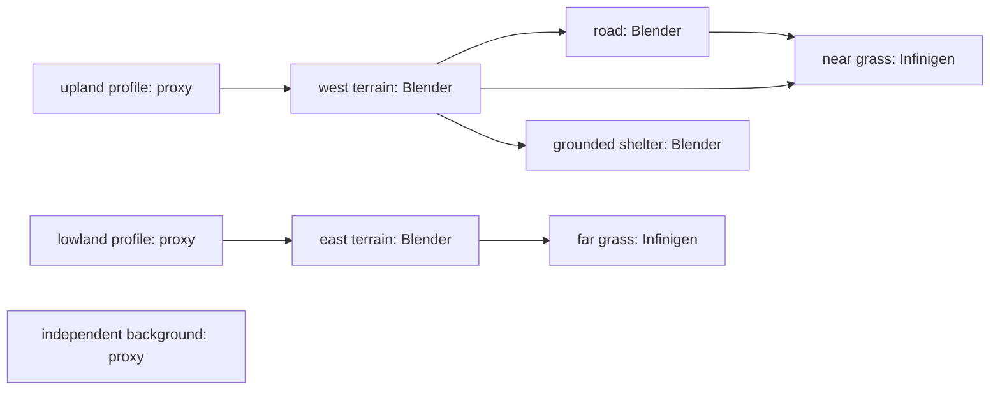

# OutdoorGraph v0.2.1: Unified Executable Generative Graph

This increment implements the runtime substrate for executable dependencies.
It does not claim Agentic Generative Mechanism Induction or a new terrain or
vegetation generator. Existing systems stay separate and retain their own
environments, assets and licenses.

## One program graph, one scheduler

Scene IR identifies registered typed programs. The same `Planner` resolves
producer/consumer ports, validates a DAG, computes execution order and dispatches
proxy or real Blender callbacks. Native callbacks execute inside Blender; an
external adapter may own an isolated inference process. There is no switch on
authoring IDs such as `moge_surface` or `infinigen_grass`.

IR schema `0.1` and legacy CLI inputs remain compatible. Optional dependency
ports and executable lifecycle status describe the new gates without another
schema version. The [operator API](execution_api.md) defines the actual contract.

## Validation is evidence, not confidence

New dependencies default to proposed. A semantic edge remains a hypothesis
until explicit typed validation through an extensible RelationSpec registry.
Endpoints, ports, kinds, required inputs and executable topology are checked.
Legacy validated declarations receive the same checks, including allowed semantic
roles, ports and required validators. Missing-status legacy edges stay proposed
until an explicit migration validation; confidence never supplies evidence. Generation then validates
upstream artifacts, operator pre/postconditions and related hard constraints.
Only successful completion and relation-specific evidence for the exact endpoints
produce executable status in the returned IR and evidence in `dependency_reports`. Unrelated passed checks cannot
certify an edge.
Failures preserve their reasons and block dependent work; the CLI rejects the
run. A high confidence score never substitutes for any gate.

The implementation checks contact, sampled road geometry, grade, road exclusion,
population, shared terrain boundaries and road topology. Surface geometry is
discretized; finite sampling is reported honestly. We detect violations rather
than optimize an infeasible graph automatically.

## Cache invalidation follows executable structure

Each result records the operator release/backend, parameters, bounds, seed,
provenance and dependency bindings. Upstream result identities propagate changes
into consumer signatures. Rewiring/removing dependencies changes the consumer
even if its parameters are unchanged. Declared external images/NPZ/meshes/textures
contribute streamed content identities per node; in-place byte changes invalidate
only their consumers, while unchanged contents retain cache hits. The MoGe adapter
declares its consumed geometry and reference texture, and reloads private packed
images on rebuild. Missing or invalid cached/backend resources are rebuilt;
a missing declared input file instead fails safely. No caller-supplied graph-version assertion or dirty set is necessary.

Real Blender collections serve as backend resources. The worker opens the
previous saved scene, reuses unaffected nodes and rebuilds only invalid nodes.
Native grass gets a per-node support snapshot so a local terrain replacement
does not invalidate another region implicitly. Post-edit validation compares
actual object/mesh/instance/custom-property records, not only Python artifacts.

## Controlled editing experiment

The hand-authored metric scene has two adjacent patches forming a continuous
heightfield surface, two independent native grass regions, a dense terrain
conforming road and a grounded shelter proxy. Terrain discretization reuses the
existing `height_at`; grass geometry/distribution reuse Infinigen.

Edit A adds a compactly supported height bump in the west. Only that profile,
west terrain, road, near grass and shelter should rebuild. Edit B widens the
road, updating it and near grass while preserving both terrain regions, far
grass and the shelter. Unchanged resume and independent fresh fixed-seed builds
test reuse and determinism. A deliberately floating road tests failure reporting.

Each successful stage must produce a real openable BLEND and rendered PNG. A
fresh Blender process checks saved geometry, dense road mesh face/edge/interior
samples, native instances, contact, clearance and GLB import. The
[validation report](integration_validation_v0.2.1.md) records measured results.

## Scope and limitations

This is a controlled dependency-editing experiment, not automatic reconstruction
from an input photograph. The original MoGe reference-image path remains
available. Patch relationships and operator choices are manually authored.
Cross-edit grass correspondences are guaranteed for preserved regions, not for
regenerated density fields. Instance-center clearance does not prove entire
blades are outside the road. Contact of a support origin or bottom center does
not prove full physical support. Automatic program induction, general global
optimization, collision solving and unseen geometry remain future work.
