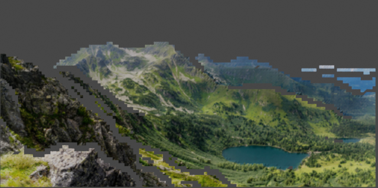
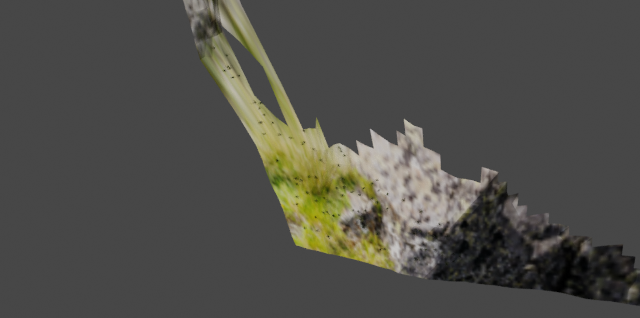

# Mountain adapter example

This small example records a real **MoGe v2 → Scene IR → Infinigen grass → Blender** run. MoGe inferred a single-view surface; Infinigen's existing grass factory and Geometry Nodes scatter generated **86 grass instances**. Blender rendered both images with CPU Cycles, 16 samples, at 640×318.

The files are copied or extracted from the completed `runs/mountain_v02_verified` run. The three PNG files preserve their original bytes. [validation_summary.json](validation_summary.json) contains measured checks and hashes of the original reports; [provenance.json](provenance.json) records input, source revisions, model ID, manual inputs, seed and dependency versions. Large geometry, scene files, weights and logs are not included in this directory.

## Images

Reference-camera render:



Local manual-region view from a different camera:



Manual candidate grass mask, in the 512×254 inference-image pixel grid:


The local view exposes stretched image textures and incomplete geometry. Grass is difficult to distinguish at this framing; its actual presence and placement are verified numerically below. Neither image is a held-out ground-truth view.

## Reproduce

Prepare the independent backends and local weights first. Installing OutdoorGraph alone does not install MoGe, Infinigen, Blender, or their native dependencies. The integration loads a local checkpoint in offline mode. See the [main installation instructions](../../README.md), [backend inventory](../../docs/integration_inventory.md), and [adapter contract](../../docs/adapter_interface.md).

Use the source revisions and model ID in [provenance.json](provenance.json). This run used separate environments:

- OutdoorGraph 0.2.0: Python 3.11.16.
- MoGe v2: Python 3.13.15, torch 2.13.0+cu126, NumPy 2.5.2; inference on an NVIDIA A100 GPU. The selected MoGe source requires Python ≥3.10; 3.13 is the verified local version.
- Infinigen 1.3.3: Python 3.10 dependencies, NumPy 1.26.2, gin-config 0.5.0.
- Blender 3.6.0: bundled Python 3.10.12, CPU generation/rendering with four threads.

The selected MoGe source defaults to CUDA 13 wheels; this run used a CUDA 12.6 PyTorch wheel. Choose the backend build compatible with the local GPU driver. The version details above document the measured environment, not an automatic environment installer. The helper revision declared by MoGe is recorded separately because the local helper checkout had no Git metadata.

From the repository root, with an isolated OutdoorGraph Python 3.11 environment active:

```bash
python -m pip install -e '.[dev]'
cp configs/integration_mountain.json configs/integration_mountain.local.json
# Edit the copied JSON and replace every /path/to/... value with a local path.
outdoorgraph integrate \
  --config configs/integration_mountain.local.json \
  --out runs/my_mountain_v02
```

Keep the machine-specific `*.local.json` file untracked. The configuration parser expands `~` and resolves relative paths against the configuration file's directory; it does **not** expand `$ENV_VAR` strings. The output directory must be new. [config.json](config.json) is an archival copy of the same portable configuration template; its placeholders must also be edited before execution.

Keep the image, seed 2026, manual polygon, mesh stride, model settings and vegetation settings unchanged to reproduce this example. Density is computed from a target of 80 instances and the reconstructed selected surface area. Actual scatter counts can differ from that target. Stable instance snapshots require the same backend and dependency configuration; arbitrary parameter or version changes do not preserve per-instance identity.

## Input and scope

The input is [`example_images/05_Mountain.jpg` from the pinned MoGe source](https://github.com/microsoft/MoGe/blob/74fbce054ebed49800de42d0ad0e83495065719a/example_images/05_Mountain.jpg), originally 2048×1015. Its SHA256 is `670d322f6588713f7d9c7349091de0aacb2a5b0b37c7b7433995e110fb2bcfbc`. It was EXIF-oriented, converted to RGB and resized without cropping to 512×254. The image source, checkpoint and third-party software retain their own upstream notices; no checkpoint or third-party implementation is bundled here.

The candidate grass polygon and level-camera/no-roll world orientation are manual inputs. The dependency from surface to grass is a declared adapter contract. The pipeline does not infer semantic regions, gravity, generating mechanisms, hidden geometry, or a globally optimized scene. The reference-camera surface uses the source image as its texture, so visual similarity in that view does not measure reconstruction accuracy. Geometry is a 2.5D single-view surface with holes, texture stretching and uncertain monocular scale.

## Measured verification

A fresh Blender process reopened the saved scene, audited its embedded bundle and provenance, decoded both PNG files, and independently imported the GLB:

- 5,464 reconstructed vertices and 9,741 faces; 438 selected faces.
- 86 actual native grass instances, with **86/86 instance centers** projecting inside the manual mask.
- Maximum **instance-origin** distance to the reconstructed surface: **8.31394×10⁻⁶ model m**, below the 0.001 m check tolerance. Scale is model-estimated, not surveyed.
- Maximum camera projection error: **2.97055×10⁻⁵ pixels**.
- One packed image and seven unique saved object IDs, with matching embedded bundle and provenance.
- Both 640×318 PNG files decoded to finite, spatially varying pixels.
- GLB imported as two mesh objects with 90,255 faces and matching node/source extras.

These checks concern instance centers/origins and interchange integrity. They do not establish that every blade stays inside the mask, that grass is collision-free, that the scene is physically correct, or that unseen surfaces were recovered. Full measured values and the precise check scope are in [validation_summary.json](validation_summary.json).
