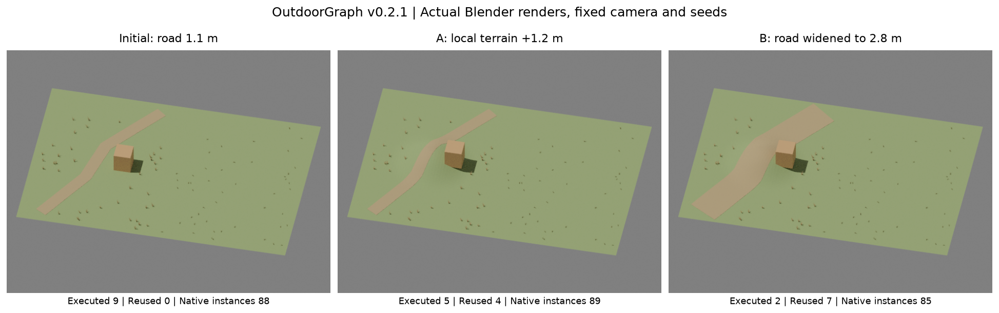

# Unified graph: real incremental editing



All panels are actual Blender 3.6 CPU renders (640×480, 16 samples), with the same
camera. Grass comes from native Infinigen GrassTuftFactory and scatter_instances.
This is a hand-authored editing experiment, not image-driven program induction.

| Stage | Executed | Reused | Near/far native instances | Road mesh samples | Max road contact error |
|---|---:|---:|---|---:|---:|
| Initial | 9 | 0 | 39 / 49 | 3870 | 0.015008 m |
| A: local terrain +1.2 m | 5 | 4 | 40 / 49 | 3870 | 0.020847 m |
| B: road 1.1 → 2.8 m | 2 | 7 | 36 / 49 | 9169 | 0.022245 m |

The road contact limit is 0.025 m, including its explicit 0.015 m rendering offset.
The actual shared terrain edge has zero measured gap at 129 samples (limit
0.0001 m). B's nearest grass center is 2.217455 m from the road centerline, above
the required half-width + buffer of 2.0 m. This does not prove blade containment.

Unchanged resume reuses all 9 nodes. Rewiring the road into the far grass input
rebuilds exactly that consumer and preserves 8 nodes, with identical saved
geometry/instance/custom-property records. Deleting that node removes only its
owned resources. Missing the BLEND cache rebuilds 6 backend nodes and reuses 3
proxy results. Fresh fixed-seed generation matches incremental geometry/instances.

Two actual negative cases are rejected: a road raised 0.4 m, and different mesh
resolutions whose analytic terrain profiles agree but whose actual shared edge
differs by 0.045546 m. Failure reports revoke executable status and cached success.

Reproduce with the [scene](../../configs/unified_scene.json) and
[backend template](../../configs/unified_blender.json):

```bash
cp configs/unified_blender.json configs/unified_blender.local.json
# Fill in installed Blender/Infinigen/site-packages paths in the local file.
outdoorgraph graph-demo --scene configs/unified_scene.json \
  --config configs/unified_blender.local.json --out runs/unified_v021
OUTDOORGRAPH_BLENDER_CONFIG="$PWD/configs/unified_blender.local.json" \
  python -m pytest -q tests/test_blender_graph.py
```

The demo creates initial/A/B/unchanged/fresh stages. The real regression suite
also creates dependency-edit, deletion, cache-loss and expected-failure cases.
BLEND/GLB are deliberately excluded from Git. Actual run files are under
`runs/unified_v021_acceptance_final/<stage>/blender/`; use a new output directory
for reproduction. See [measured results](metrics.json),
[dependency visualization](terrain_dependency.svg), the
[validation report](../../docs/integration_validation_v0.2.1.md), and
[operator API](../../docs/execution_api.md).
