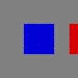
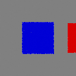

# P0 external-input cache regression — actual Blender outputs

These are unmodified 64x64 Blender RGB renders from the final regression run.
The two planes are an **authored MoGe-format NPZ loader fixture**, not model
inference or a new reconstruction result. Native grass uses the existing
Infinigen factory/scatter; all successful stages independently reopen BLEND
and import GLB. The right surface is an independent preserved branch.

| Original | Same-path texture replaced | Same-path NPZ raised by 0.5 m |
|---|---|---|
|  |  |  |

The left packed image changes from red to blue; the right remains red. Only
`surface_main` and `native_plants` rebuild for each edit. An unchanged run reuses
all four nodes. Deleting the main NPZ fails safely and blocks its native grass,
while preserving the independent surface and background. Actual mesh vertices
and grass origins move to z=0.5 m after the geometry edit. Small image resolution
is intentional; numerical evidence is in [results.json](results.json).

```bash
cd ~/outdoor
# Activate the isolated project environment; configure the existing backend.
cp configs/unified_blender.json configs/unified_blender.local.json
# Fill the three existing backend paths in the local config.
OUTDOORGRAPH_BLENDER_CONFIG="$PWD/configs/unified_blender.local.json" \
OUTDOORGRAPH_EXTERNAL_OUTPUT="$PWD/runs/my_external_cache_regression" \
  python -m pytest -q tests/test_blender_external_inputs.py
```

Use a new output directory. The test authors the small inputs, records exact
requests/configuration/logs and saves each BLEND, GLB, RGB, Scene IR, execution
state, snapshots, geometry/reopen report and packed-image audit. Seed 19,
density 2, one native asset, scale 1; the calibrated fixture camera renders at
64x64. Large/generated NPZ/BLEND/GLB and machine-local paths are excluded from Git.
See the [complete P0 report](../../../docs/p0_review_validation_v0.2.1.md).
